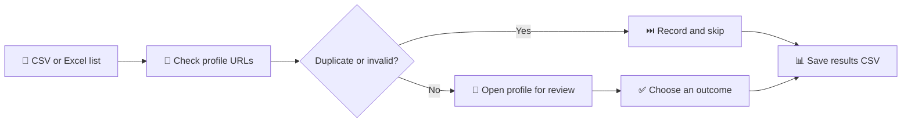

<div align="center">


<br />


**A small Python project for keeping LinkedIn connection outreach organized, one profile at a time.**

[Get started](#-getting-started) · [How it works](#-how-it-works) · [Request the optional auto-invite code](#-request-the-optional-auto-invite-code) · [Contact](#-contact)

</div>

---

## 👋 Welcome

Networking is easier when you can focus on people instead of juggling tabs and remembering whom you have already contacted.

I put this toolkit together to make connection outreach from a participant list or spreadsheet a little more manageable. It helps you prepare profile links, avoid duplicates, keep track of your progress, and return to the list without starting over.

The **public review script** opens profiles for you to review. **It does not send LinkedIn invitations automatically.** An optional Selenium-based invitation helper is discussed separately below.

## ✨ What this project does

| | Feature | What it means for you |
|:---:|---|---|
| 📊 | **CSV & Excel support** | Bring an existing `.csv`, `.xlsx`, or `.xlsm` participant list. |
| 🔗 | **Profile URL validation** | Skip empty or invalid links rather than opening them. |
| 🧹 | **Duplicate detection** | Avoid reviewing the same LinkedIn URL twice. |
| 👀 | **Human review** | Check each person's profile and invitation status before acting. |
| 📝 | **Progress tracking** | Save your decisions in a separate results CSV. |
| 🔄 | **Resume later** | Continue a review using the saved results instead of beginning again. |
| 🔐 | **No stored passwords** | The public review script uses your regular browser; it does not request credentials. |

## 🧭 How it works



**Example input:** Your spreadsheet needs **at least four columns**. The script reads LinkedIn profile links from **column D**, the fourth column (index `3`).

| A · Name | B · Group | C · Notes | D · LinkedIn URL |
|---|---|---|---|
| Example Person | Learning Cohort | Met during program | `https://www.linkedin.com/in/your-profile-slug/` |

> The URL above is a placeholder, not a real participant profile. Use your own authorized participant list. To read URLs from another column, change `URL_COLUMN_INDEX = 3` in the Python script (`0` means column A).

## 🚀 Getting started

### 1. Download the project

On GitHub, choose **Code → Download ZIP**, then extract the folder. If you use Git, you can clone the repository instead.

### 2. Check your Python installation

Open **Windows Command Prompt** in the project folder and run:

```bat
python --version
```

If Python is not installed, download it from [python.org](https://www.python.org/downloads/). A currently supported Python version with compatible packages is recommended.

### 3. Create a virtual environment (recommended)

```bat
python -m venv .venv
.venv\Scripts\activate
```

### 4. Install the requirements

```bat
python -m pip install --upgrade pip
python -m pip install -r requirements.txt
```

The requirements file contains the direct dependencies `pandas`, `openpyxl`, and `selenium`. Selenium is only needed for the separate, optional browser-automation helper.

### 5. Add your spreadsheet

Put your input file in the same folder as the script. It can be named `linkedin_database.csv` or anything you prefer.

### 6. Start your connection review

For a CSV:

```bat
python linkedin_connection_review.py "linkedin_database.csv"
```

For an Excel file:

```bat
python linkedin_connection_review.py "participants.xlsx"
```

The script opens each valid, unique profile in your default browser. **You** check the profile and decide whether to send a request using LinkedIn's own interface.

When the terminal asks for a result, type one of these codes:

| Type | Record as | When to use it |
|:---:|---|---|
| `s` | `sent` | You manually sent an invitation. |
| `c` | `connected` | You are already connected. |
| `p` | `pending` | A request is already pending. |
| `k` | `skipped` | You don't want to invite this person. |
| `e` | `error` | Something went wrong; revisit later. |
| `q` | Save and quit | You want to stop for now. |

Your progress is saved next to the source file, for example:

```text
linkedin_database_review_results.csv
```

Run the same command again to resume your review. Check the recorded statuses before making further changes.

## 💌 A connection note you can adapt

Here's a friendly note for meeting people through a course, program, or community:

> Hi! I'd love to connect, exchange ideas, support each other's journeys, and stay in touch beyond the program. Looking forward to connecting!

Make it your own wherever possible. A short, relevant note usually feels more personal than a generic introduction.

## 🤖 Request the optional auto-invite code

Interested in the **optional Selenium-based invitation helper** that attempts to attach a note when sending a connection invitation?

✉️ **Email:** [preranapandit07@gmail.com](mailto:preranapandit07@gmail.com?subject=LinkedIn%20Auto-Invite%20Code%20Request)

Please use **“LinkedIn Auto-Invite Code Request”** as the subject and briefly tell me how you plan to use it. I can share more information about the code and its limitations.

**Important:** For learning purpose only!


## 📬 Contact

Have a question, found a bug, or want to ask about the optional invitation helper? I'd love to hear from you.

**[📧 preranapandit07@gmail.com](mailto:preranapandit07@gmail.com?subject=LinkedIn%20Connection%20Toolkit)**

---

<div align="center">

**Connect thoughtfully. Keep track. Make it meaningful.** ✨

<sub>A community-friendly Python toolkit for organizing outreach — not an official LinkedIn product.</sub>

</div>
